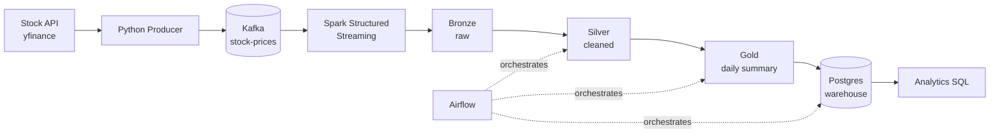
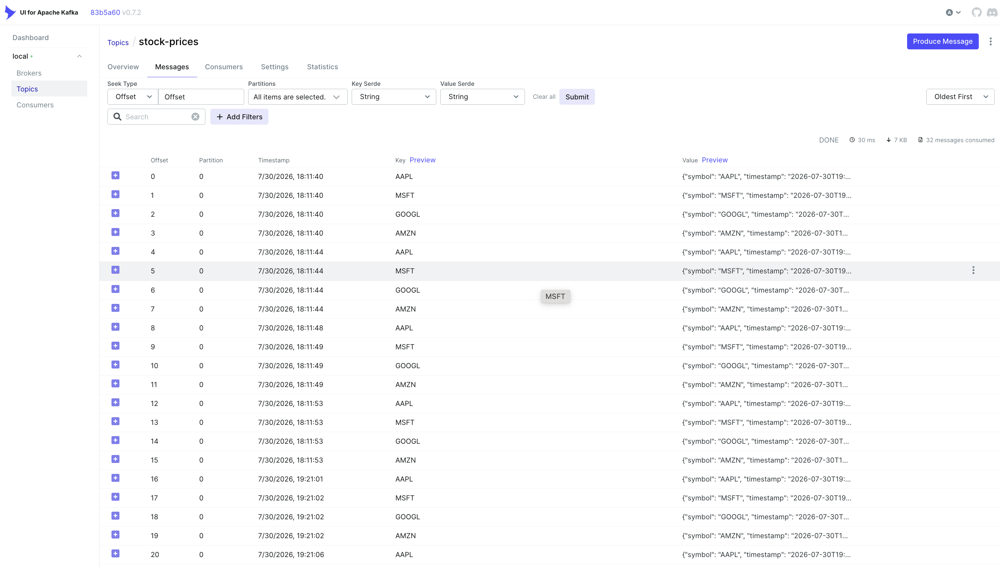
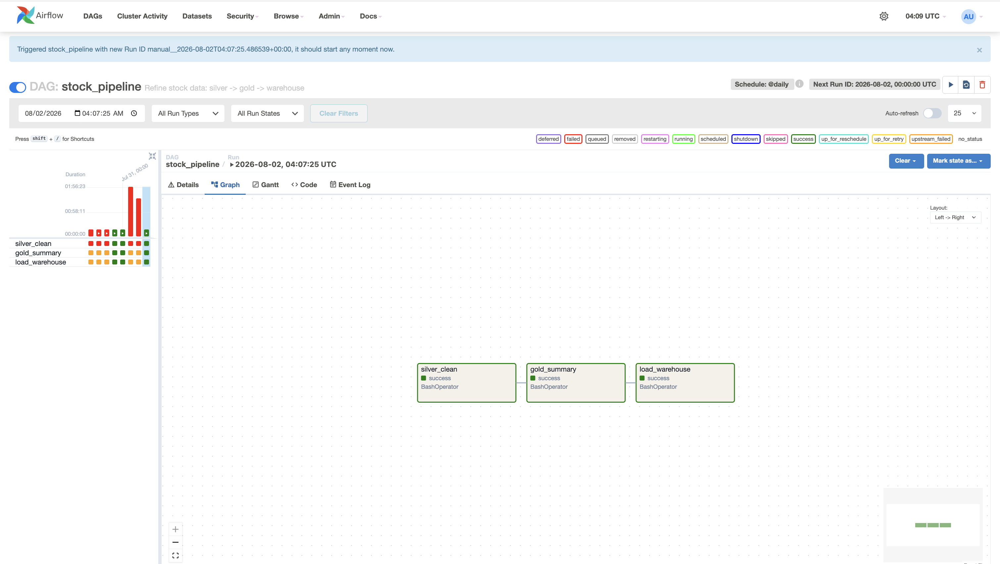
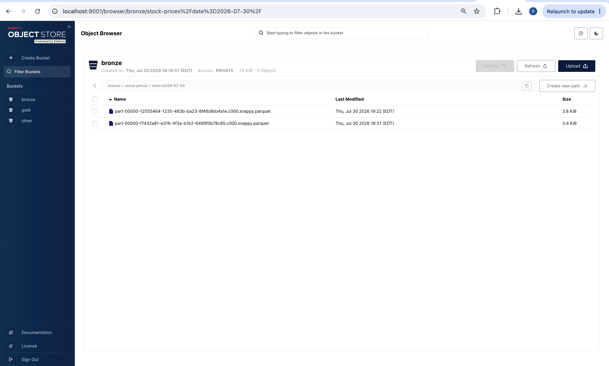
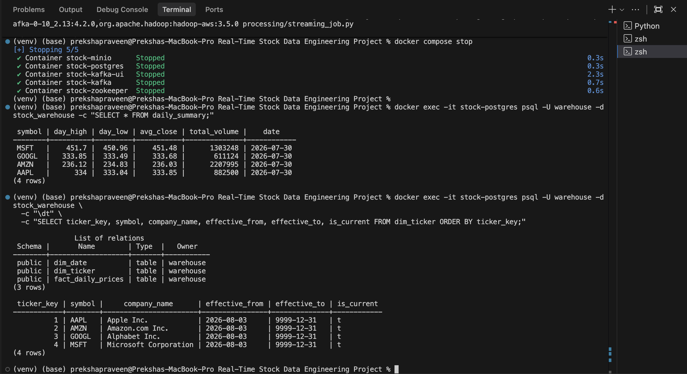
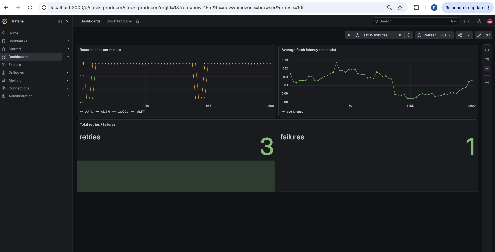

# Real-Time Stock Data Engineering Pipeline


An end to end streaming pipeline that ingests live stock market data, processes it in real
time through a bronze/silver/gold data lake, and loads it into a warehouse for analytics.

## Why this project?

Stock prices change constantly while the market is open, and the data loses value quickly as
it ages. That makes it a natural fit for streaming rather than batch: instead of waiting for a
once a day job, this pipeline reacts to new prices as they arrive, so a dashboard or an alert
can work off near real time data. The business problem it solves is keeping an analytics
warehouse continuously up to date with fresh market data, so analysts can answer questions
like "which stock moved the most today?" without waiting for tomorrow's load. It also serves
as a hands on reference for the streaming plus medallion (bronze/silver/gold) pattern that is
common across the industry.

## Tech stack

Python, Kafka, Spark Structured Streaming, Airflow, MinIO, PostgreSQL, Docker.

## Architecture



A polished diagram will replace this later. See [docs/architecture.md](docs/architecture.md)
for the data contract, topic design, and failure scenarios.

## Sample event

Each Kafka message is one price observation for one ticker, keyed by its symbol:

```json
{
  "symbol": "AAPL",
  "timestamp": "2026-08-01T19:59:00Z",
  "open": 210.10,
  "high": 210.55,
  "low": 209.80,
  "close": 210.35,
  "volume": 882500,
  "source": "yfinance",
  "interval": "1m",
  "currency": "USD",
  "ingested_at": "2026-08-01T19:59:04Z"
}
```

## Getting started

Prerequisites: Docker Desktop. Everything, including the producer, Spark and Airflow, runs in
containers.

```bash
# Configuration: copy the template, then fill in your values
cp .env.example .env

# Build the images and start the whole pipeline
docker compose up -d --build
```

This starts the producer, Kafka, the Spark streaming job (Kafka to bronze), MinIO, Postgres,
Airflow and monitoring. Handy URLs once the stack is up:
- Airflow: http://localhost:8081 (login from `AIRFLOW_ADMIN_USER` / `AIRFLOW_ADMIN_PASSWORD`)
- MinIO console: http://localhost:9001
- Kafka UI: http://localhost:8080
- Grafana: http://localhost:3000

Stop the stack with `docker compose down`.

To run a batch job by hand instead of through Airflow:

```bash
docker compose run --rm spark-batch python processing/silver_job.py
docker compose run --rm spark-batch python processing/gold_job.py --batch-date 2026-10-27
docker compose run --rm spark-batch python warehouse/load_to_warehouse.py
```

### Orchestration (Airflow)

The DAG in `dags/stock_pipeline_dag.py` runs the batch refinement (silver -> gold -> warehouse)
once a day, with retries and a failure alert after the last retry. Airflow runs as a webserver
and a scheduler (LocalExecutor) with its metadata in Postgres. Its image is built on the Spark
image, so tasks run the Spark jobs directly with the same Java and connector jars.

### Local development

The unit tests need a Python environment with PySpark and a JVM:

```bash
python3 -m venv venv && source venv/bin/activate
pip install -r requirements.txt
```

## Tests

```bash
pytest
```

Unit tests cover the transform logic (deduplication, aggregation, the date dimension) and the
producer's record shaping, run on small in-memory data with external systems mocked.

## Screenshots

**Kafka UI, live messages in the `stock-prices` topic**



**Airflow, the pipeline DAG running green**



**MinIO, the bronze / silver / gold data lake**



**Postgres, the Gold star schema (fact table + SCD Type 2 dimensions)**



**Grafana, live producer metrics (throughput, fetch latency, retries and failures)**



## Repository layout

```
ingestion/    stock data producer and its Dockerfile
processing/   Spark streaming (bronze) and batch jobs (silver, gold), Dockerfile for Spark and Airflow
warehouse/    load into Postgres and analytics SQL
dags/         Airflow DAG that orchestrates the pipeline, and its failure alert
scripts/      container setup scripts
monitoring/   Prometheus and Grafana configuration
docs/         architecture notes and diagrams
```
```

